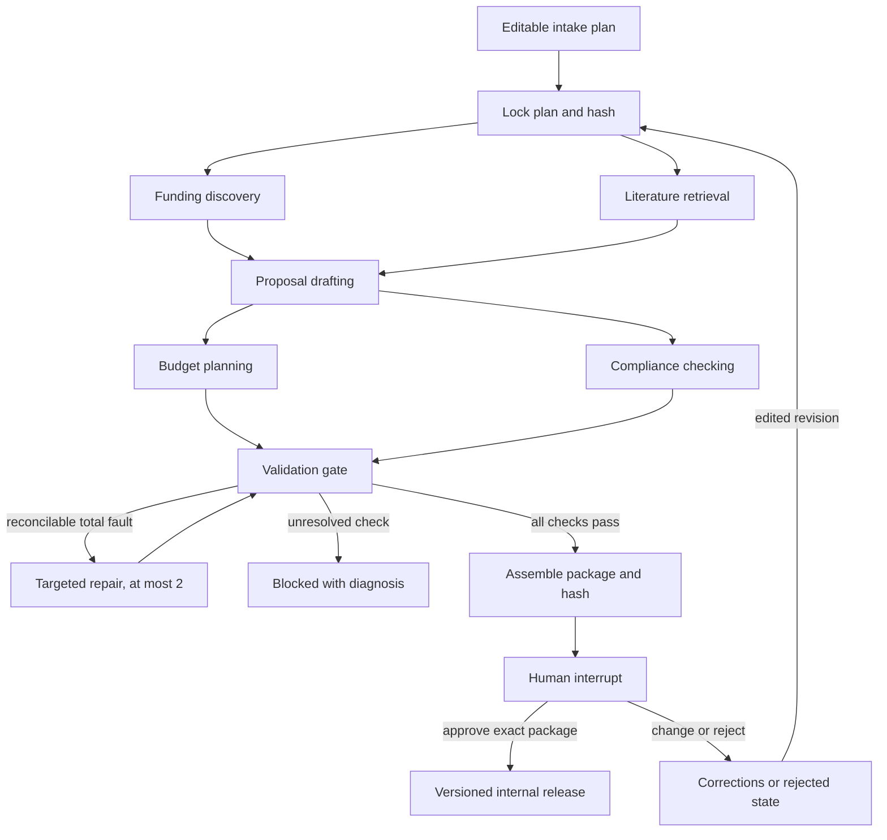

# Architecture and contracts

## Stack

- Python 3.12 reference environment; FastAPI typed HTTP API.
- Pydantic request, plan, budget, evidence and registry contracts.
- LangGraph StateGraph with SqliteSaver and dynamic interrupt/Command resume.
- SQLite WAL for users, sessions, plans, runs, evidence, immutable registry records, versions and hash-chained audit.
- Plain HTML/CSS/JavaScript, served from the same origin. No third-party scripts/fonts/CDNs.
- Local Ollama with automatic availability detection over fixed loopback HTTP; no cloud provider is enabled.

The fan-in edges are explicit lists: both discovery/literature must finish before drafting; both budget/compliance must finish before validation. Within discovery, up to four workers score distinct calls and a deterministic merge selects a matching candidate by plan alignment. Invalid candidates and reasons are logged.

## Single data surface

`Connector` is the only data-facing surface used by specialist agents. It provides typed reads, scoped evidence lookup, hashing-embedding retrieval, candidate scoring, budget calculation and optional model access. `/api/connector/read` exposes the same typed surface under session authentication; it is an MCP-style connector, **not an implementation of the MCP wire protocol**. Switching a backend source belongs in this connector rather than in agents.

Raw college history is immutable application reference data. Mutable run state lives in checkpoint threads. A new revision creates a new thread, retaining the original run identity and prior released versions. Prior-run retrieval respects owner/department permissions and does not mix unapproved narratives into institutional source facts.

## Agents

| Component | Input | Output and boundary |
|---|---|---|
| AURA-style coordinator runtime | Typed locked plan | Hash, run/thread identity, attempts, audit, wall-clock budget |
| Funding discovery | Area, type, duration, mode, optional call ID | Ranked candidates, exclusion reasons, selected call |
| Literature review | Area and title | Cited institutional metadata/abstracts; explicit novelty limitation |
| Proposal drafting | Plan, call, literature | Marked working narrative; structured local-model abstract, methodology and risks |
| Budget planning | Justified integer-INR lines | Products, sums, category totals via calculator |
| Compliance checking | Call-specific rules and evidence | Consent, freshness, evidence, documents, ethics and duration checks |
| Validation | All outputs and locked plan | Boolean acceptance report; no package on failure |
| Repair | Exact diagnosis | Recompute inconsistent total only; unchanged source figures |
| Submission/assembly | Passing report | Generic review package, content hash, no external action |
| Human gate | Exact package hash and named actor | Approval, changes or rejection |
| Governance | Approval and current permissions | Immutable internal release, audit, rollback pointer |

The supplied worklet names “apniLeap AURA Coordinator” as the architectural role. This project implements that role in LangGraph; it does not claim to include a proprietary AURA SDK.

## Approval and concurrency

The server serializes mutations using one process-wide lock; run with **one uvicorn worker**. SQLite checkpoints persist completed supersteps. Interrupted/error runs can resume with the same thread. The human interrupt has no side effect before `interrupt()`; recording a release is idempotent for a package hash. Repeated/stale approval requests are rejected.

Approval checks server-side role/scope, run status, package hash, current deadline and source/evidence validity. Post-approval edits clear the active version and run validation again. Restore selects a previously approved immutable package; it does not rewrite its contents or claim to retract an external submission.

The audit is a hash chain, not an externally anchored or cryptographically signed tamper-proof log. It detects accidental changes through its verifier; an administrator controlling both database and code could recompute it. Production needs independent retention/monitoring where required.

## Evidence and financial semantics

- Budget values use whole INR integers, preventing floating-point reconciliation errors. Quantities and rates are explicit; no hidden conversion, automatic tax or unstated overhead.
- Historical amounts keep `sanctioned`, `received` and `applied` meanings separate.
- Guidelines, policies, eligibility and ethics remain user-retained evidence. Human authenticity review is a requirement.
- Original source text is data, never executable instructions. The app never executes user-generated Python/SQL, and LLM output cannot select tools or authorize release.
- Government, industry and international profiles have different proposed narrative focuses; numerical rules always come from the selected call.

## Source references for implementation

- https://docs.langchain.com/oss/python/langgraph/interrupts
- https://docs.langchain.com/oss/python/langgraph/persistence
- https://reference.langchain.com/python/langgraph.checkpoint.sqlite
- Supplied worklet: `data/originals/Agentic_AI_15_Worklets_14Lab_Build_Book(1).md`, Chapter 13.

Runtime library versions are pinned in `requirements-lock.txt`; the broad supported constraints are in `requirements.txt`.

## Version 2 model integration

`app/llm.py` centralizes Ollama status, structured JSON generation, citation-ID validation and bounded repair. Both the assistant and proposal node reach it through Connector. Office settings stores the model configuration. Invalid output is never silently accepted. The default is automatic local-model use, with explicit fallback when unavailable. Password recovery is available to the local operator and authenticated office administrators; it revokes sessions without deleting proposals.
