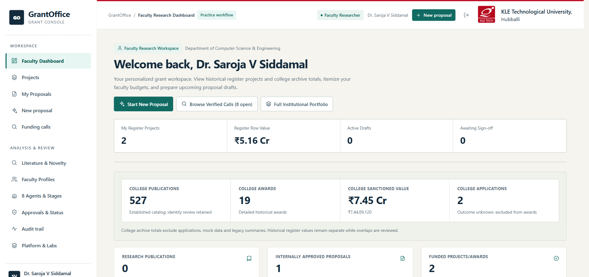
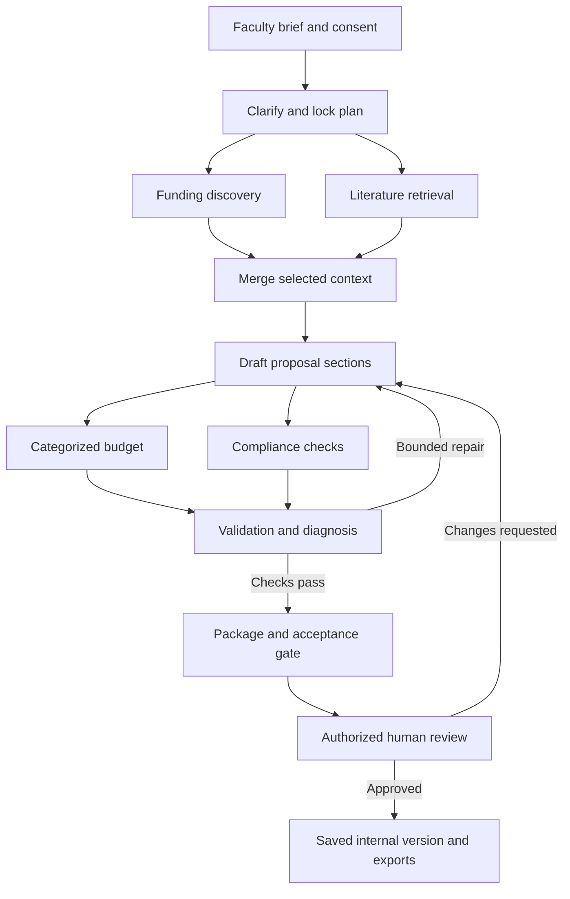

# Research Grant Management System (apniLeap AURA)

**GrantOffice | Agentic AI (26ECAC401) | Worklet 13 | KLE Technological University, Hubballi**

A research-grant workspace for faculty intake, funding-call discovery, literature search, proposal drafting, budget validation and human review. **Agents draft and flag; the Dean R&D / Research Office approves.**



## 1. Team

**Team 13**

| Name | USN | Division |
| --- | --- | --- |
| Soujanya Tikare | 01FE23BCI064 | B-DIV |
| K. Tharun Babu | 01FE23BCI078 | B-DIV |
| NT Basavaraj | 01FE23BCI113 | B-DIV |
| K. Rohith | 01FE23BCI031 | B-DIV |

## 2. Quick links

| Resource | Location |
| --- | --- |
| All 14 assignments | [Assignments](Assignments/README.md) |
| Application source | [Backend](Course-Project/backend/) / [Frontend](Course-Project/frontend/) |
| Problem statement | [Original document](Course-Project/Problem_Statement/Research_Grant_Management_System.docx) |
| Technical documentation | [Documentation index](Course-Project/docs/README.md) |
| Final report | [Markdown](Course-Project/Final_Report/GrantOffice_Technical_Report.md) / [DOCX](Course-Project/Final_Report/Final_Report_Research_Grant_Management_System.docx) / [PDF](Course-Project/Final_Report/Final_Report_Research_Grant_Management_System.pdf) |
| Lab evidence | [Traces and artifacts](Course-Project/evidence/README.md) |

## 3. Repository structure

```text
Research-Grant-Management-System/
├── README.md
├── requirements.txt
├── .gitignore
├── Assignments/                 # Lab 1–14 notebooks with retained outputs
│   └── scripts/                 # Python scripts, seed data and notebook builder
└── Course-Project/
    ├── README.md                # Technical overview and setup
    ├── Problem_Statement/       # Original worklet problem statement
    ├── Final_Report/            # Markdown, DOCX and PDF report
    ├── backend/                 # Express API, agents, engine and tests
    ├── frontend/                # React/Vite interface
    ├── evidence/                # Supplied lab artifacts
    └── docs/                    # Guides, screenshots and course originals
```

The independent Python edition, earlier lab support, verification tools and Windows launchers are also retained inside `Course-Project/`. The preserved workflow definition and Git attributes are also stored inside `Course-Project/`, keeping the repository root to the five entries shown above.

## 4. Assignments overview

The fourteen labs develop the worklet incrementally, from an editable plan to an integrated grant-management workflow. Each supplied lab has a standalone Python script and a retained notebook. The scripts use the Python standard library and do not require provider credentials.

| Lab | Topic and implementation | Notebook | Demonstrated behavior | Checks |
| --- | --- | --- | --- | --- |
| 1 | [Agent vs Chatbot](Assignments/scripts/lab01_agent_vs_chatbot.py) | [Lab 1](Assignments/LAB_1_Worklet13_Agent_vs_Chatbot.ipynb) | Clarify a brief, propose a plan and revise the same plan using feedback. | 10/10 |
| 2 | [Tool-Using Agent](Assignments/scripts/lab02_tool_using_agent.py) | [Lab 2](Assignments/LAB_2_Worklet13_Tool_Using_Agent.ipynb) | Validate typed tool inputs and centralize financial arithmetic behind controlled tools. | 10/10 |
| 3 | [Skill Creation](Assignments/scripts/lab03_skill_creation.py) | [Lab 3](Assignments/LAB_3_Worklet13_Skill_Creation.ipynb) | Reuse schema-checked planning and formatting skills across funding domains. | 11/11 |
| 4 | [Memory and Retrieval](Assignments/scripts/lab04_memory_and_retrieval.py) | [Lab 4](Assignments/LAB_4_Worklet13_Memory_and_Retrieval.ipynb) | Separate session state from scoped retrieval, ranked references and permission-gated writes. | 8/8 |
| 5 | [MCP-Style Connector](Assignments/scripts/lab05_mcp_connector.py) | [Lab 5](Assignments/LAB_5_Worklet13_MCP_Connector.ipynb) | Demonstrate source discovery, scoped access, caller permissions and connector audit. | 10/10 |
| 6 | [Runtime and Audit](Assignments/scripts/lab06_runtime.py) | [Lab 6](Assignments/LAB_6_Worklet13_Runtime.ipynb) | Apply step/tool budgets, user-scoped memory, checkpoints and escalation. | 10/10 |
| 7 | [Agentic Node Graph](Assignments/scripts/lab07_agentic_node_graph.py) | [Lab 7](Assignments/LAB_7_Worklet13_Node_Graph.ipynb) | Execute explicit stages with parallel branches, bounded retry and a human gate. | 10/10 |
| 8 | [Parallel Swarm](Assignments/scripts/lab08_parallel_swarm.py) | [Lab 8](Assignments/LAB_8_Worklet13_Parallel_Swarm.ipynb) | Fan out section specialists with ThreadPoolExecutor and merge their outputs. | 10/10 |
| 9 | [Evidence Grounding](Assignments/scripts/lab09_deep_research.py) | [Lab 9](Assignments/LAB_9_Worklet13_Deep_Research_Grounding.ipynb) | Build claim-level evidence records and reject unresolved or out-of-scope sources. | 10/10 |
| 10 | [Ops Resilience](Assignments/scripts/lab10_ops_resilience.py) | [Lab 10](Assignments/LAB_10_Worklet13_Ops_Resilience.ipynb) | Inject faults, diagnose their cause and apply bounded targeted repairs. | 11/11 |
| 11 | [Agentic SDLC Factory](Assignments/scripts/lab11_sdlc_factory.py) | [Lab 11](Assignments/LAB_11_Worklet13_SDLC_Factory.ipynb) | Use acceptance criteria as a release gate and detect a deliberately faulty artifact. | 9/9 |
| 12 | [Safety and Governance](Assignments/scripts/lab12_safety_governance.py) | [Lab 12](Assignments/LAB_12_Worklet13_Safety_and_Governance.ipynb) | Enforce review roles, evaluation, audit, versioning and restoration. | 11/11 |
| 13 | [Domain Specialists](Assignments/scripts/lab13_discipline_specialists.py) | [Lab 13](Assignments/LAB_13_Worklet13_Domain_Specialists.ipynb) | Apply government, industry/CSR and international specialist contracts. | 8/8 |
| 14 | [Integrated Capstone](Assignments/scripts/lab14_capstone.py) | [Lab 14](Assignments/LAB_14_Worklet13_Capstone.ipynb) | Integrate intake, drafting, budget, validation, review and a saved internal release. | 12/12 |

**Recorded result: 140/140 trace assertions across fourteen scripts.** The verifier runs each script in an isolated temporary directory, captures its output and applies the notebook's terminal acceptance assertions. These are trace checks, not 140 additional independent application tests. Existing notebook outputs and supplied evidence remain preserved.

```sh
python Course-Project/tools/verify_labs.py
```

[Assignment details and evidence links](Assignments/README.md) / [Earlier independent lab programs](Assignments/LEGACY_LABS.md).

## 5. Course project - Research Grant Management System

### 5.1 Problem statement

Research-grant preparation brings together funding announcements, faculty expertise, literature, research methods, costs, supporting documents and institutional approval. When these tasks are handled in separate files and conversations, the faculty member and reviewing office can lose track of which information is current and which checks have actually passed.

The project addresses six connected problems:

1. **Scattered opportunities:** funding calls are distributed across agency websites and notices, making matching, deadlines and eligibility difficult to track together.
2. **Disconnected research evidence:** literature metadata and institutional research history need to be searchable, attributable and available while a proposal is drafted.
3. **Inconsistent proposal versions:** narrative, methodology, budget and compliance evidence can drift apart as different people revise them.
4. **Unreliable financial changes:** automatic adjustments can change faculty-entered amounts or hide the basis of overheads, contingencies and category caps.
5. **Limited review visibility:** the reviewing office needs a consolidated view of progress, blocking issues and the exact package being approved.
6. **Unclear activity counts:** scholarly papers, internally approved proposals and sanctioned projects must remain separate concepts, even when they appear on the same faculty dashboard.

GrantOffice responds with a shared, source-aware workflow that records inputs, coordinates preparation, checks artifacts and requires an authorized human decision before internal release.

| Stakeholder | Need addressed |
| --- | --- |
| Faculty / Principal Investigator | Prepare a proposal within their research scope, control their costs and inspect evidence and feedback. |
| HoD | Understand departmental progress and participate according to assigned authority. |
| Dean R&D / Research Office | Review the complete package, request changes and retain a traceable decision. |
| Research administrators | Inspect institutional records, provenance, storage diagnostics, versions and audit events. |

Authority is enforced through configured permissions and ownership, rather than granted by a stakeholder label alone. The unchanged [original problem statement](Course-Project/Problem_Statement/Research_Grant_Management_System.docx) and [implementation mapping](Course-Project/docs/SCOPE_MAPPING.md) distinguish the course's original real-case objective from the implemented practice workflow.

### 5.2 Objectives

- **Coordinate preparation:** take a faculty brief through consent, clarification, a locked plan, discovery, drafting, validation and review.
- **Keep evidence inspectable:** retain source identifiers and provenance for institutional records and public research metadata.
- **Preserve financial intent:** capture submitted inputs, use explicit expense categories, calculate deterministic totals and require acceptance of proposed financial changes.
- **Prevent stale approval:** bind human review to the current package and invalidate approval when its narrative, budget or relevant context changes.
- **Maintain institutional visibility:** present permission-filtered proposal activity alongside clearly separated publication and award records.
- **Support recovery and reuse:** persist workflow state, keep immutable versions, explain Restore scope and export selected saved packages in usable formats.
- **Demonstrate agentic concepts:** connect all fourteen lab capabilities to executable implementations and identifiable evidence.

### 5.3 Approach and end-to-end workflow

The coordinator uses parallel execution where tasks can progress independently and sequential gates where content integrity, validation or approval requires a consistent result. The main application implements this graph in JavaScript.

| Stage | Execution approach | Output and control |
| --- | --- | --- |
| Intake and clarification | Sequential coordinator checks | Research brief, consent, faculty associations and an auditable input snapshot. |
| Plan preparation | Editable plan followed by locking | Objectives, scope, methodology and task instructions shared by the following stages. |
| Discovery | Funding and literature tasks run concurrently | Ranked practice calls and source-labeled research context. |
| Context reconciliation | Coordinator merge | Selected-call requirements and evidence carried into drafting. |
| Proposal drafting | Structured drafting with a section swarm | Narrative sections checked against plan/source contracts; failures record template fallback. |
| Budget and compliance | Concurrent task setup with a budget dependency | Itemized totals and a checklist; financial compliance waits for the calculated budget. |
| Validation and repair | Bounded diagnosis and targeted retry | Corrected structural artifacts or a clear blocking outcome. The default repair budget is three. |
| Packaging and acceptance | Sequential release gate | Saved files, manifest and hashes only after the required checks pass. |
| Human review | Authorized decision on the opened package | Approval, rejection or corrections routed back into the workflow. |
| Internal release | After valid approval | Immutable saved version, refreshed activity and authenticated exports. |



The eight visible roles are coordinator, funding discovery, literature review, proposal drafting, budget planning, compliance checking, packaging and human review. The last role is a person. Internal release does not transmit an application to a funding agency.

### 5.4 Implementation

#### Architecture and technology

The React/Vite console calls the Express API using a server-issued bearer session. API routes enforce ownership and permissions before reading or changing a proposal. The coordinator invokes typed tools and specialist stages, records progress and pauses at the human review gate.

| Component | Actual implementation | Responsibility |
| --- | --- | --- |
| Frontend | React 19 / Vite 8, [frontend source](Course-Project/frontend/src/) | Dashboards, intake, project/archive browsing, proposal stages, review and diagnostics. |
| API | Node.js / Express 5, [api.js](Course-Project/backend/src/api.js) | Authentication, ownership, mutation controls, review, versions and downloads. |
| Workflow engine | [engine.js](Course-Project/backend/src/engine.js) | Graph stages, plan lifecycle, validation, acceptance, governance and metrics. |
| Agent stages | [agents.js](Course-Project/backend/src/agents.js) | Discovery, literature, drafting, budget, compliance, packaging and targeted repair. |
| Shared runtime | [core.js](Course-Project/backend/src/core.js) | Typed tools, scoped connectors, skills, memory, runtime limits and audit. |
| Monetary rules | [budget-rules.js](Course-Project/backend/src/budget-rules.js) | Whole-INR arithmetic, charge permissions, categories and cap denominators. |
| Faculty identity | [researcher-directory.js](Course-Project/backend/src/researcher-directory.js) | Stable researchers, supported aliases and conservative project reconciliation. |
| Proposal activity | [proposal-activity.js](Course-Project/backend/src/proposal-activity.js) | Distinct, permission-filtered counts and current approval validity. |
| Research retrieval | [research-sources.js](Course-Project/backend/src/research-sources.js) | Offline archive search, public OpenAlex topics and independent Crossref enrichment. |
| Drafting providers | [model.js](Course-Project/backend/src/model.js), [llm-drafting.js](Course-Project/backend/src/llm-drafting.js) | Optional Ollama/Qwen or explicitly selected Groq, structured-output checking and fallback reporting. |
| Persistence | [atomic-store.js](Course-Project/backend/src/atomic-store.js), [persistence.js](Course-Project/backend/src/persistence.js) | Atomic local writes, safe failure reporting and optional MongoDB integration. |
| Document exports | [exports.js](Course-Project/backend/src/exports.js) | Genuine saved-package DOCX/PDF using docx and PDFKit. |

The separate [Python edition](Course-Project/langgraph_edition/) uses FastAPI, LangGraph, Pydantic and SQLite with its own interface, startup and operational stores. It is not the engine behind the React console. The JavaScript application's scoped connectors demonstrate MCP-style concepts; a verified MCP wire-protocol implementation or installed OpenClaw runtime is not claimed.

#### Institutional data and source provenance

The application reads annual college publication workbooks, detailed funded-project/application workbooks, a legacy sanctioned-project document and supplemental CSV exports. Normalized records retain source filenames, sheets and rows. A catalog-bound reconciliation sidecar preserves conflicting fields and pending identity candidates without silently replacing established records.

| Collection | Established records | Meaning |
| --- | --- | --- |
| Research publications | 527 | Scholarly catalog records, with author and source metadata. |
| Detailed historical awards | 19 | Source-supported sanctioned awards, separate from proposal releases. |
| Applications | 2 | Application records with a distinct financial/outcome meaning. |
| Historical project register | 30 rows | A separate register that can overlap detailed awards. |

These collections are not disjoint: their counts and financial amounts must not simply be added together. Sanctioned, received and requested amounts are distinct; an unknown received amount is not treated as a known zero. [Data sources and reconciliation rules](Course-Project/docs/DATA_AND_IDENTITIES.md).

#### Faculty identities and activity counts

Supported full-name variants and explicit aliases resolve to stable researcher IDs. Paper authors, home-author fields and PI/co-PI evidence are considered without merging researchers merely because they share a first name. Reviewed register/catalog overlaps retain both original records and visible amount conflicts.

Profiles and dashboards distinguish **research publications**, **proposals created**, **awaiting review**, **internally approved proposals** and **funded awards**. Multiple versions remain one proposal. A regression fixture with one approved proposal, no linked papers and no sanctioned award correctly produces **1 / 0 / 0**. A changed working package loses its current approval claim while its earlier decision remains in history. Private proposal details stay filtered by the viewer's permission.

#### Budget correctness

Expenses use explicit personnel, equipment, consumables, travel and other categories. Faculty-submitted whole-INR costs are retained in an auditable input snapshot. Configured charge permissions, percentage bases and category-cap denominators determine the totals; missing charges are not assumed to apply.

The following regression fixture uses explicit **TEST rules**, not real agency policy:

| Item | INR |
| --- | ---: |
| Personnel | 250000 |
| Equipment | 150000 |
| Consumables | 50000 |
| Direct cost | **450000** |
| TEST overhead: 15% of direct | 67500 |
| TEST contingency: 5% of direct | 22500 |
| Total request | **540000** |

Percentage charges use rational intermediates and round half up once to whole INR. A minimum above the resulting request causes an eligibility failure rather than inflated expenses. Ceiling/cap alternatives remain separate until explicitly accepted. Acceptance or a confirmed correction invalidates stale validation, package and approval; historical approved snapshots remain unchanged. Legacy uncategorized costs and compatibility-helper policy assumptions remain visibly qualified. [Budget and governance details](Course-Project/docs/CORRECTNESS.md).

#### Providers, storage and failure behavior

- **Research:** institutional archive browsing is offline and paginated. Public OpenAlex topic retrieval and Crossref DOI enrichment have independent outcomes, retained source labels and safe missing-key/rejected-key/rate/timeout/network diagnostics. A college fallback record is not labeled successful OpenAlex retrieval.
- **Drafting:** local Ollama/Qwen is optional; Groq is used only when explicitly selected. Invalid or unavailable model output records template fallback. Resolving a source ID checks structure, not scientific truth or novelty.
- **Storage:** local JSON is the acknowledged primary workflow store. Unique temporary files, flush/rename and bounded Windows lock retries preserve the last valid file; persistent failures surface rather than returning a successful save. Optional MongoDB supports account/project administration and asynchronous workflow mirroring.
- **Boundaries:** main sign-in sessions and runtime-created accounts in fallback mode are memory-only. JSON assumes one writer per directory. The independent Python edition uses separate SQLite/checkpoint state.

#### Review, Restore and exports

Human review is bound to the current package's artifact/context fingerprints. Changes cannot inherit an old decision. Restore requires the existing rollback permission, explains the selected version and scope before confirmation, deep-copies saved context and keeps the original version immutable. Missing historical fields remain unavailable rather than borrowing current content. Exact historical approval provenance is identified as history, not a new review.

Authenticated Markdown/CSV and package files remain available alongside genuine **DOCX and PDF**. Exports use the selected saved package/version, preserve amounts and disclosures, and do not generate new model text. Invalid versions, unauthorized access and stale current packages fail clearly.

### 5.5 Installation and execution

Use Node 24. From repository root:

```sh
npm --prefix Course-Project/backend ci
npm --prefix Course-Project/frontend ci
npm --prefix Course-Project/frontend run build
```

For a new installation, copy [the example configuration](Course-Project/backend/.env.example) to Course-Project/backend/.env. Preserve an existing .env. For deterministic offline drafting, set `AURA_LLM=off`; provider credentials and MongoDB are optional.

```sh
cd Course-Project/backend
npm start
```

Open **http://localhost:3000**. The selector and `password123` are classroom demonstration authentication. Windows launchers: [setup.bat](Course-Project/setup.bat), [start.bat](Course-Project/start.bat), [verify.bat](Course-Project/verify.bat).

For development, run `npm --prefix Course-Project/backend run dev` and `npm --prefix Course-Project/frontend run dev` in separate terminals from root. Vite uses port 5173 and proxies API calls to port 3000.

Local AI requires an installed Ollama service and `ollama pull qwen2.5:3b`; use `GRANT_LLM=ollama`, `AURA_LLM=on`. Keep keys server-side. See [complete setup and configuration](Course-Project/docs/SETUP.md), including the independent Python edition on port 8000 and Unicode-font requirements for PDF export.

### 5.6 Results and verification

The following results were recorded during the completed verification on **19 November 2026**. These are separate scopes; repeated/subset runs are not added to the totals. The same offline checks remain available through [verify.bat](Course-Project/verify.bat).

| Verification scope | Recorded result | Evidence |
| --- | --- | --- |
| Main backend API/engine | **50 passed**, zero failed/skipped | [Backend tests](Course-Project/backend/tests/) |
| Frontend lint | **0 errors, 0 warnings** | Existing ESLint rules retained. |
| Frontend production build | **Passed** | Vite production compilation. |
| Fourteen supplied labs | **140/140 trace assertions** | [Lab evidence mapping](Assignments/README.md) |
| Independent Python application | **66 passed** | [Python tests](Course-Project/langgraph_edition/tests/) |
| Earlier lab-support suite | **70 passed** | [Support tests](Course-Project/code/Lab_Support/tests/) |
| Relocated application startup | **Passed** | Built app and Vite loaded on ports 3000/5173; zero page runtime errors in that smoke check. |
| Saved-package/report documents | **Structural and PDF checks passed** | Genuine OOXML/PDF, saved content, table and rendered-page checks; native Word rendering remained blocked. |

Implemented behavior demonstrated by the regressions includes:

1. **Financial preservation:** the TEST fixture reconciles exactly; high minimums and ceilings do not silently change entered costs.
2. **Identity separation:** supported aliases resolve consistently while homonyms remain separate; overlapping awards retain their sources/conflicts.
3. **Correct counters:** internal proposal approval does not create a research paper or funded award, and multiple versions do not multiply proposal counts.
4. **Approval integrity:** changed content cannot pass as the previously opened package; explicit corrections require renewed validation/review.
5. **Persistent failure handling:** temporary-store restart checks reload saved records; transient locks retry and persistent failures return errors while preserving valid data.
6. **Version-safe exports:** current/historical DOCX and PDF require authorized access, use the correct snapshot and leave approved content immutable.
7. **Governed recovery:** unauthorized Restore is refused and subsequent working edits do not mutate the source approved version.
8. **Honest provider outcomes:** controlled tests distinguish retrieval success, empty results and error categories while preserving independent Crossref/college behavior.

[Full verification record and limitations](Course-Project/docs/VERIFICATION.md) / [Previous GitHub Actions runs](https://github.com/Tharunbabu06/Research-Grant-Management-System/actions).

Reproduce the main checks from repository root:

```sh
npm --prefix Course-Project/backend test
npm --prefix Course-Project/frontend run lint -- --max-warnings 0
npm --prefix Course-Project/frontend run build
python Course-Project/tools/verify_labs.py
python Course-Project/tools/check_docs.py
```

### 5.7 Demonstration guide

| Screen / action | What to demonstrate |
| --- | --- |
| Faculty Dashboard | Separate publication/proposal/award counts and linked register projects. |
| Projects / My Grants | Canonical PI/co-PI associations, source records and financial conflicts. |
| Research archive | Search fields, pagination, original provenance and separate public-provider outcomes. |
| New proposal | Research scope, consent, methodology, public keywords, categorized costs and locked plan. |
| Proposal detail | Discovery, draft/evidence, exact budget, compliance, validation and saved package. |
| Budget correction / alternatives | Explicit confirmation, preserved original input and invalidation of stale approval. |
| Authorized review | Decision on the opened package; faculty permissions must not grant reviewer authority. |
| Versions and downloads | Current/historical Word/PDF and existing formats; read Restore scope before confirming. |
| Audit / Platform | Recorded actions, actual storage mode and provider/runtime diagnostics. |

Use a disposable practice proposal for edits, failure injection and Restore. Preserve operational records and approved history. [Step-by-step demo](Course-Project/docs/USER_GUIDE.md).

## 6. Documentation

| Document | Purpose |
| --- | --- |
| [Technical overview](Course-Project/README.md) | Course-project entry point and launchers. |
| [Architecture](Course-Project/docs/ARCHITECTURE.md) | Components, stages, stores and trust boundaries. |
| [Data and identity rules](Course-Project/docs/DATA_AND_IDENTITIES.md) | Sources, deduplication, provenance and count definitions. |
| [Correctness and governance](Course-Project/docs/CORRECTNESS.md) | Budget, provider, approval, export and Restore behavior. |
| [Scope mapping](Course-Project/docs/SCOPE_MAPPING.md) | Original requirements, implementation evidence and remaining gaps. |
| [Verification](Course-Project/docs/VERIFICATION.md) | Commands, results and mocked/live/blocked distinctions. |
| [Screenshots](Course-Project/docs/screenshots/README.md) | Current capture provenance and historical-image labels. |
| [Final report](Course-Project/Final_Report/README.md) | Substantive editable Markdown and genuine DOCX/PDF. |
| [Course originals](Course-Project/docs/originals/) | Unchanged build book, guide, canvas and review-sheet templates. |

## 7. Limitations and future work

This release is a local course-project practice workflow with authentic institutional archive/history browsing. Seeded calls, policies, quotations and generated estimates are labeled practice material. Software checks do not certify an actual agency's requirements, scientific novelty or college acceptance of a genuine-current-call proposal.

Current limitations include locally unconfigured MongoDB, single-writer JSON, memory-only fallback account/session behavior, unresolved historical input/context gaps and unverified live-model quality. Prior OpenAlex diagnostics returned 401/503; those results are not presented as current successful connectivity. Native Word COM rendering was blocked even though DOCX structure and PDF rendering were checked.

Future work includes office-approved live-call/policy ingestion, verified quotations and eligibility evidence, expert citation/novelty review, campus SSO and hardened session management, operational backup/recovery, reviewed remaining source conflicts and a real-case institutional acceptance study. No measured productivity improvement, production deployment or automated funding submission is claimed. [Detailed limitations](Course-Project/docs/LIMITATIONS.md).

## 8. Attribution

The supplied reference project, GrantOffice/Python edition, college source records and earlier lab implementations retain their attribution. Course-issued originals and historical evidence remain unchanged. No new license, completed review sheet, faculty signature or institutional approval has been invented.

## 9. Documentation Links

| Resource | Link |
| --- | --- |
| Assignment folder | [Assignments](Assignments/) |
| Project documentation | [Project documentation folder](Course-Project/docs/) |
| Final report | [Final report folder](Course-Project/Final_Report/) - [Markdown](Course-Project/Final_Report/GrantOffice_Technical_Report.md), [DOCX](Course-Project/Final_Report/Final_Report_Research_Grant_Management_System.docx), [PDF](Course-Project/Final_Report/Final_Report_Research_Grant_Management_System.pdf) |
