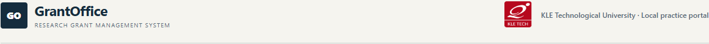
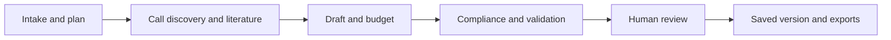

# Research Grant Management System (apniLeap AURA)

**GrantOffice | Agentic AI (26ECAC401) | Worklet 13 | KLE Technological University, Hubballi**

A research-grant workspace for faculty intake, funding-call discovery, literature search, proposal drafting, budget validation and human review. **Agents draft and flag; the Dean R&D / Research Office approves.**



## 1. Team

**Team 13**

| Name | USN |
| --- | --- |
| Soujanya Tikare | 01FE23BCI064 |
| K. Tharun Babu | 01FE23BCI078 |
| NT Basavaraj | 01FE23BCI113 |
| K. Rohith | 01FE23BCI031 |

## 2. Quick links

| Resource | Location |
| --- | --- |
| All 14 assignments | [Assignments](Assignments/README.md) |
| Application source | [Backend](Course-Project/backend/) / [Frontend](Course-Project/frontend/) |
| Problem statement | [Original document](Course-Project/Problem_Statement/Research_Grant_Management_System.docx) |
| Technical documentation | [Documentation index](Course-Project/docs/README.md) |
| Final report | [Markdown](Course-Project/Final_Report/GrantOffice_Technical_Report.md) / [DOCX](Course-Project/Final_Report/Final_Report_Research_Grant_Management_System.docx) / [PDF](Course-Project/Final_Report/Final_Report_Research_Grant_Management_System.pdf) |
| Lab evidence | [Traces and artifacts](Course-Project/evidence/README.md) |

## 3. Repository structure

```text
Research-Grant-Management-System/
├── README.md
├── requirements.txt
├── .gitignore
├── Assignments/                 # Lab 1–14 notebooks with retained outputs
│   └── scripts/                 # Python scripts, seed data and notebook builder
└── Course-Project/
    ├── README.md                # Technical overview and setup
    ├── Problem_Statement/       # Original worklet problem statement
    ├── Final_Report/            # Markdown, DOCX and PDF report
    ├── backend/                 # Express API, agents, engine and tests
    ├── frontend/                # React/Vite interface
    ├── evidence/                # Supplied lab artifacts
    └── docs/                    # Guides, screenshots and course originals
```

The independent Python edition, earlier lab support, verification tools and Windows launchers are also retained inside `Course-Project/`. GitHub automation remains in `.github/`.

## 4. Assignments overview

Each supplied lab includes a standalone Python script and notebook. The verifier executes scripts in isolated directories and checks their output traces; no API key is required.

| Lab | Topic and script | Notebook |
| --- | --- | --- |
| 1 | [Agent vs Chatbot](Assignments/scripts/lab01_agent_vs_chatbot.py) | [Lab 1](Assignments/LAB_1_Worklet13_Agent_vs_Chatbot.ipynb) |
| 2 | [Tool-Using Agent](Assignments/scripts/lab02_tool_using_agent.py) | [Lab 2](Assignments/LAB_2_Worklet13_Tool_Using_Agent.ipynb) |
| 3 | [Skill Creation](Assignments/scripts/lab03_skill_creation.py) | [Lab 3](Assignments/LAB_3_Worklet13_Skill_Creation.ipynb) |
| 4 | [Memory and Retrieval](Assignments/scripts/lab04_memory_and_retrieval.py) | [Lab 4](Assignments/LAB_4_Worklet13_Memory_and_Retrieval.ipynb) |
| 5 | [MCP-Style Connector](Assignments/scripts/lab05_mcp_connector.py) | [Lab 5](Assignments/LAB_5_Worklet13_MCP_Connector.ipynb) |
| 6 | [Runtime and Audit](Assignments/scripts/lab06_runtime.py) | [Lab 6](Assignments/LAB_6_Worklet13_Runtime.ipynb) |
| 7 | [Agentic Node Graph](Assignments/scripts/lab07_agentic_node_graph.py) | [Lab 7](Assignments/LAB_7_Worklet13_Node_Graph.ipynb) |
| 8 | [Parallel Swarm](Assignments/scripts/lab08_parallel_swarm.py) | [Lab 8](Assignments/LAB_8_Worklet13_Parallel_Swarm.ipynb) |
| 9 | [Evidence Grounding](Assignments/scripts/lab09_deep_research.py) | [Lab 9](Assignments/LAB_9_Worklet13_Deep_Research_Grounding.ipynb) |
| 10 | [Ops Resilience](Assignments/scripts/lab10_ops_resilience.py) | [Lab 10](Assignments/LAB_10_Worklet13_Ops_Resilience.ipynb) |
| 11 | [Agentic SDLC Factory](Assignments/scripts/lab11_sdlc_factory.py) | [Lab 11](Assignments/LAB_11_Worklet13_SDLC_Factory.ipynb) |
| 12 | [Safety and Governance](Assignments/scripts/lab12_safety_governance.py) | [Lab 12](Assignments/LAB_12_Worklet13_Safety_and_Governance.ipynb) |
| 13 | [Domain Specialists](Assignments/scripts/lab13_discipline_specialists.py) | [Lab 13](Assignments/LAB_13_Worklet13_Domain_Specialists.ipynb) |
| 14 | [Integrated Capstone](Assignments/scripts/lab14_capstone.py) | [Lab 14](Assignments/LAB_14_Worklet13_Capstone.ipynb) |

**Verified:** 140/140 trace assertions across 14 labs. [Purposes, per-lab results and evidence](Assignments/README.md).

```sh
python Course-Project/tools/verify_labs.py
```

## 5. Course project

### Problem and objectives

Faculty manage scattered funding calls, literature, drafts and budgets with limited visibility across review stages. GrantOffice connects these tasks in one workspace for faculty, HoDs, Dean R&D and the Research Office.

- Match calls and retrieve source-labeled research metadata.
- Draft proposals within the faculty's plan and methodology.
- Preserve entered costs and validate categorized budgets and compliance.
- Require authorized review; retain audit events and immutable versions.
- Export saved packages as Markdown, CSV, DOCX and PDF; confirm historical Restore.

### Workflow



### Technology

| Layer | Implementation |
| --- | --- |
| Frontend | React 19, Vite 8 |
| Main backend | Node.js, Express 5; JavaScript workflow |
| Drafting | Optional Ollama/Qwen or explicitly selected Groq |
| Research | Offline college archive, OpenAlex and Crossref |
| Storage | Local JSON; optional MongoDB |
| Separate edition | Python, FastAPI, LangGraph and SQLite |

The Node workflow and Python/LangGraph edition run independently. Practice calls and policies are labeled synthetic; internal approval does not submit externally or create a funding award. [Scope and limitations](Course-Project/docs/LIMITATIONS.md).

### Run locally

Use Node 24. From the repository root:

```sh
npm --prefix Course-Project/backend ci
npm --prefix Course-Project/frontend ci
npm --prefix Course-Project/frontend run build
```

Copy [Course-Project/backend/.env.example](Course-Project/backend/.env.example) to Course-Project/backend/.env, preserving existing configuration. For offline drafting, set `AURA_LLM=off`. Then:

```sh
cd Course-Project/backend
npm start
```

Open **http://localhost:3000**. Classroom demo password: `password123`. Windows users can use [setup.bat](Course-Project/setup.bat) and [start.bat](Course-Project/start.bat). [Configuration and Python setup](Course-Project/docs/SETUP.md).

### Verification

Recorded on 19 November 2026; counts describe separate scopes.

| Check | Result |
| --- | --- |
| Main backend | 50 tests passed |
| Frontend lint / production build | Passed; zero lint warnings |
| Supplied labs | 140/140 trace assertions |
| Independent Python application | 66 tests passed |
| Earlier lab-support suite | 70 tests passed |

[Commands and verification details](Course-Project/docs/VERIFICATION.md) / [GitHub Actions](https://github.com/Tharunbabu06/Research-Grant-Management-System/actions).

## 6. Demo and documentation

Sign in, inspect the archive and project records, create a practice proposal, review its budget and validation, approve using an authorized role, then inspect versions and downloads. Use a disposable practice record to demonstrate Restore.

[Demo guide](Course-Project/docs/USER_GUIDE.md) / [Architecture](Course-Project/docs/ARCHITECTURE.md) / [Data and identity rules](Course-Project/docs/DATA_AND_IDENTITIES.md) / [Final report](Course-Project/Final_Report/README.md).

Course originals and prior lab work retain their attribution. Supplied older screenshots are [labeled historical](Course-Project/docs/screenshots/README.md).
