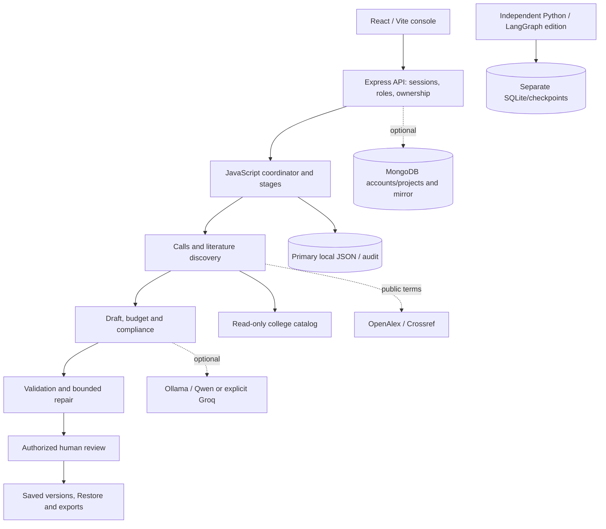

# GrantOffice — Research Grant Management System

**KLE Technological University, Hubballi | Agentic AI (26ECAC401) | Chapter / Worklet 13**

GrantOffice brings faculty intake, funding-call matching, literature metadata, proposal drafting, categorized budgets, compliance checks and human review into one auditable workspace. The current application uses React/Vite and an Express/Node workflow. A separate Python/FastAPI/LangGraph edition and preserved course labs accompany it.

**This is a course project and local practice workflow.** Seeded calls, policy rules, quotations and generated estimates are demonstration fixtures. Internal approval is neither external submission, a research publication nor a sanctioned funding award. Authentic college records retain provenance and conflict warnings.


This genuine current capture is cropped to public branding to exclude account details and private proposal content. Other supplied screenshots are [historical](Course-Project/docs/screenshots/README.md).

## Team

Team number **13** is supplied by the team; independent confirmation from a filled review sheet is pending. Division: **to be completed by the team**.

| Member | USN |
| --- | --- |
| Soujanya Tikare | 01FE23BCI064 |
| K. Tharun Babu | 01FE23BCI078 |
| NT Basavaraj | 01FE23BCI031 |
| K. Rohith | 01FE23BCI113 |

Spellings and USNs follow the supplied task/review-sheet transcription. The available sheet is blank, so independent documentary confirmation is pending. No signatures, faculty approvals or completed templates have been fabricated.

## Quick links

[Setup](Course-Project/docs/SETUP.md) | [Architecture](Course-Project/docs/ARCHITECTURE.md) | [Data and identities](Course-Project/docs/DATA_AND_IDENTITIES.md) | [Demo guide](Course-Project/docs/USER_GUIDE.md) | [Verification](Course-Project/docs/VERIFICATION.md) | [Limitations](Course-Project/docs/LIMITATIONS.md) | [Documentation index](Course-Project/docs/README.md)

[Original problem statement](Course-Project/Problem_Statement/Research_Grant_Management_System.docx) | [Current scope mapping](Course-Project/docs/SCOPE_MAPPING.md) | [Final report: Markdown](Course-Project/Final_Report/GrantOffice_Technical_Report.md) | [DOCX](Course-Project/Final_Report/Final_Report_Research_Grant_Management_System.docx) | [PDF](Course-Project/Final_Report/Final_Report_Research_Grant_Management_System.pdf) | [Repository update record](docs/REPOSITORY_UPDATE_REPORT.md)

## Problem, stakeholders and objectives

Faculty encounter scattered funding calls, slow evidence gathering, disconnected budgets and late compliance issues. Faculty/PIs need editable drafts and exact financial inputs; HoDs, Dean R&D and the Research Office need permission-scoped review, evidence and version history. The worklet coordinates these tasks while retaining named-human authority.

Implemented objectives are to preserve submitted inputs, make derived costs and evidence inspectable, distinguish institutional history from practice fixtures, reject stale approvals, and retain saved packages and audit history. Genuine-current-call institutional acceptance and external submission are outside verified scope.

## Implemented features

- Consent-based intake, plan locking, call matching, parallel discovery/section drafting, bounded repair, validation and authorized review.
- Offline institutional archive with field filters/pagination; optional OpenAlex topic search and independent Crossref DOI enrichment with safe diagnostics.
- Stable researcher IDs/explicit aliases, separate account permissions, historical-register/catalog reconciliation with retained sources/conflicts.
- Separate paper, created-proposal, awaiting-review, internally approved-proposal and funded-award counts. Several versions count as one proposal.
- Whole-INR categories, configured charge bases/permissions/caps, immutable inputs and explicit accepted adjustments; no silent inflation/rescaling.
- Durable atomic local workflow JSON, visible write errors, optional MongoDB account/project support and asynchronous workflow mirror.
- Checksum-bound review, immutable versions, confirmed Restore with historical provenance; authenticated Markdown/CSV/JSON and genuine DOCX/PDF exports.
- KLE branding, responsive redesigned interface, role/ownership boundaries and audit events.

See [correctness evidence](Course-Project/docs/CORRECTNESS.md) for source links and limits.

## Architecture and workflow



The JavaScript engine does not use LangGraph. Scoped connectors are MCP-style demonstrations without verified MCP wire compatibility. Runtime concepts do not establish an installed OpenClaw runtime. Source-ID resolution does not prove scientific truth or novelty.

## Stack and structure

Node 24 was tested; setup requires Node 22.13+ (use Node 24). Main libraries: Express 5, React 19, Vite 8, Mongoose/MongoDB, docx and PDFKit. Drafting defaults to Ollama/Qwen; Groq is optional. Labs use Python standard library; the independent edition uses FastAPI, LangGraph, Pydantic and SQLite.

```text
README.md
Assignments/                       # 14 scripts/notebooks + earlier lab programs
backend/                           # main Express source, manifests and tests
frontend/                          # main React source and lockfile
langgraph_edition/                 # independent Python app; read-only shared catalog
Course-Project/
  Problem_Statement/               # unchanged course documents
  Final_Report/                    # Markdown, DOCX and PDF report
  docs/                            # current docs and labeled history
  evidence/                        # supplied historical lab evidence
  code/Lab_Support/                # retained earlier lab support, not another app
.github/workflows/                 # offline checks after dependencies install
tools/                             # verification, hygiene and report tools
docs/REPOSITORY_UPDATE_REPORT.md
```

## Dataset sources

Supplied college workbooks (2022-26), external-funded-project/application workbooks, the legacy sanctioned-project document and CSV exports feed [the catalog](langgraph_edition/data/catalog.json): **527 established scholarly records, 19 detailed historical awards, two applications**, plus a separate **30-row historical register**. Sources overlap; do not add all counts/amounts. [Provenance](Course-Project/docs/DATA_AND_IDENTITIES.md) explains normalization, source rows and conflicts. Supplied materials retain attribution; no new redistribution license is asserted.

## Install and run

From this root with Node 24:

```sh
npm --prefix backend ci
npm --prefix frontend ci
npm --prefix frontend run build
```

Copy [backend/.env.example](backend/.env.example) to backend/.env, preserving existing configuration. PowerShell: `Copy-Item backend/.env.example backend/.env`. Offline: set `AURA_LLM=off`, leave keys and `MONGODB_URI` blank. Then:

```sh
cd backend
npm start
```

Open http://localhost:3000. The selector and `password123` are classroom authentication, not campus SSO. No operational accounts, sessions or proposals are shipped. Windows setup.bat/start.bat provide the install/build/start path.

For local drafting install Ollama, run `ollama pull qwen2.5:3b`, and set `GRANT_LLM=ollama`, `AURA_LLM=on`. Failures are recorded as template fallback. An existing valid `OPENALEX_API_KEY` enables public-topic retrieval; model health does not prove provider connectivity. [Configuration/development/Python startup](Course-Project/docs/SETUP.md).

## All 14 assignments

Each link resolves to an actual script/notebook. [Assignment details](Assignments/README.md) give purpose and real evidence; [earlier lab programs](Assignments/LEGACY_LABS.md) remain separately preserved.

| Lab | Capability | Script | Notebook |
| --- | --- | --- | --- |
| 1 | Planning/revision | [Script](Assignments/scripts/lab01_agent_vs_chatbot.py) | [Notebook](Assignments/LAB_1_Worklet13_Agent_vs_Chatbot.ipynb) |
| 2 | Typed tools | [Script](Assignments/scripts/lab02_tool_using_agent.py) | [Notebook](Assignments/LAB_2_Worklet13_Tool_Using_Agent.ipynb) |
| 3 | Reusable skills | [Script](Assignments/scripts/lab03_skill_creation.py) | [Notebook](Assignments/LAB_3_Worklet13_Skill_Creation.ipynb) |
| 4 | Memory/retrieval | [Script](Assignments/scripts/lab04_memory_and_retrieval.py) | [Notebook](Assignments/LAB_4_Worklet13_Memory_and_Retrieval.ipynb) |
| 5 | Scoped connector | [Script](Assignments/scripts/lab05_mcp_connector.py) | [Notebook](Assignments/LAB_5_Worklet13_MCP_Connector.ipynb) |
| 6 | Runtime/audit | [Script](Assignments/scripts/lab06_runtime.py) | [Notebook](Assignments/LAB_6_Worklet13_Runtime.ipynb) |
| 7 | Executable graph | [Script](Assignments/scripts/lab07_agentic_node_graph.py) | [Notebook](Assignments/LAB_7_Worklet13_Node_Graph.ipynb) |
| 8 | Parallel swarm | [Script](Assignments/scripts/lab08_parallel_swarm.py) | [Notebook](Assignments/LAB_8_Worklet13_Parallel_Swarm.ipynb) |
| 9 | Evidence grounding | [Script](Assignments/scripts/lab09_deep_research.py) | [Notebook](Assignments/LAB_9_Worklet13_Deep_Research_Grounding.ipynb) |
| 10 | Diagnosis/repair | [Script](Assignments/scripts/lab10_ops_resilience.py) | [Notebook](Assignments/LAB_10_Worklet13_Ops_Resilience.ipynb) |
| 11 | Acceptance factory | [Script](Assignments/scripts/lab11_sdlc_factory.py) | [Notebook](Assignments/LAB_11_Worklet13_SDLC_Factory.ipynb) |
| 12 | Governance/Restore | [Script](Assignments/scripts/lab12_safety_governance.py) | [Notebook](Assignments/LAB_12_Worklet13_Safety_and_Governance.ipynb) |
| 13 | Funding specialists | [Script](Assignments/scripts/lab13_discipline_specialists.py) | [Notebook](Assignments/LAB_13_Worklet13_Domain_Specialists.ipynb) |
| 14 | Integrated capstone | [Script](Assignments/scripts/lab14_capstone.py) | [Notebook](Assignments/LAB_14_Worklet13_Capstone.ipynb) |

## Fresh verification | 18 November 2026

| Scope | Actual result |
| --- | --- |
| Main backend | 50 passed; 0 failed/skipped |
| Frontend lint --max-warnings 0 | 0 errors; 0 warnings |
| Frontend production build | Passed |
| Supplied 14 labs | 140/140 trace assertions |
| Independent Python app, clean Python 3.12 | 66 passed; no warnings |
| Earlier lab-support suite, clean Python 3.12 | 70 passed; no warnings |
| Current browser | Public login capture; no page runtime errors |

Scopes are separate, not summed. [Verification](Course-Project/docs/VERIFICATION.md) records commands, runtimes, rendering and prior-versus-fresh evidence. GitHub Actions is provided; remote success is not claimed until observed.

## Limitations and demo

Local MongoDB is unconfigured. Fallback-created accounts are memory-only; JSON assumes one writer per directory. Prior OpenAlex checks returned 401/503. A recalled original budget input cannot be reconstructed; approved history remains unchanged. Native Word COM rendering was blocked; PDF rendering is separately checked. Real call/policy evidence, campus identity and production security remain future work.

Demo: sign in | inspect archive/provenance | create a labeled practice proposal with consent | inspect plan/budget/validation | authorized review | versions/downloads | read Restore scope on a disposable record. [Guide and INR 450000 TEST fixture](Course-Project/docs/USER_GUIDE.md).

## Attribution

Reasearch-grant-management-system-main (1).zip supplies course structure, notebooks and originals; current code is authoritative. The preserved GrantOffice/Python edition and earlier repository lab support retain attribution. No license, institutional signature or production deployment claim has been invented.
